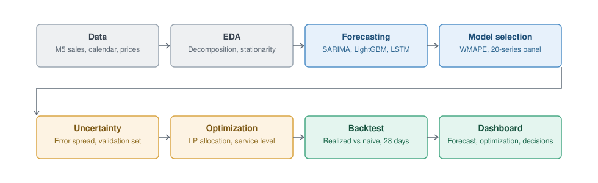
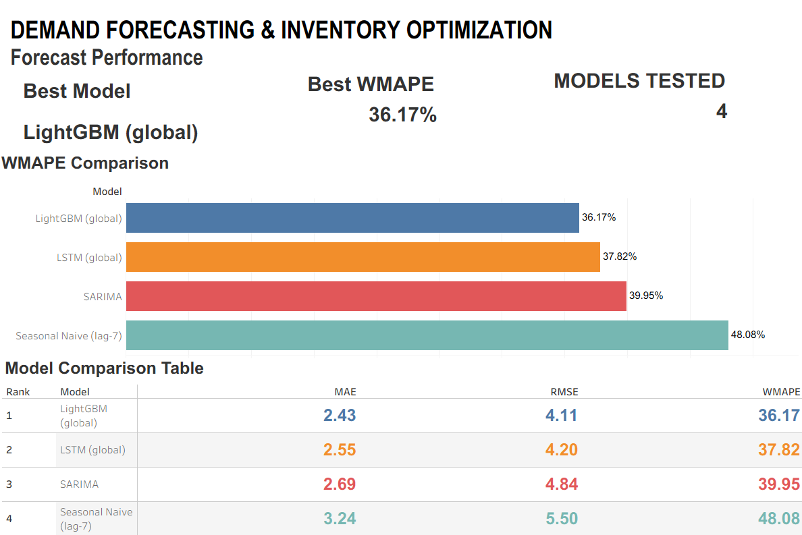
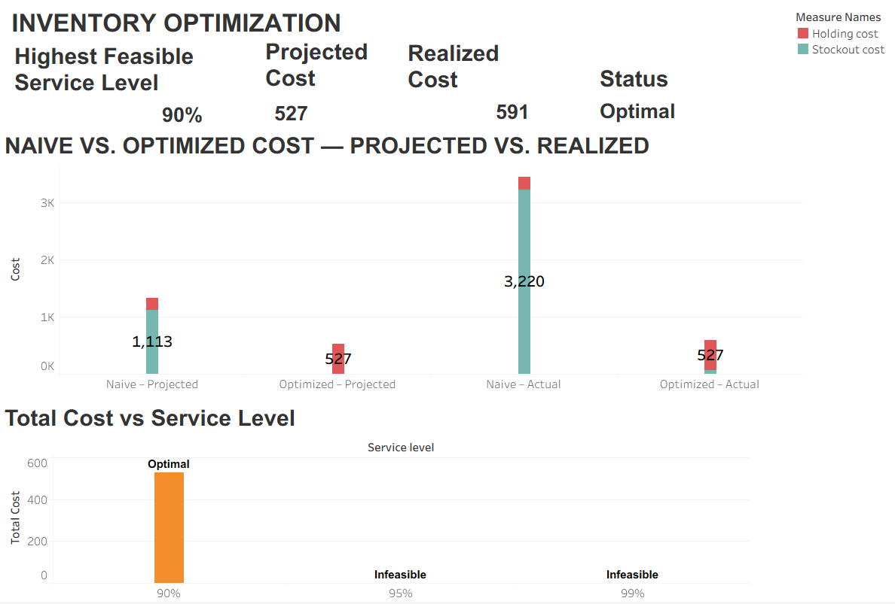
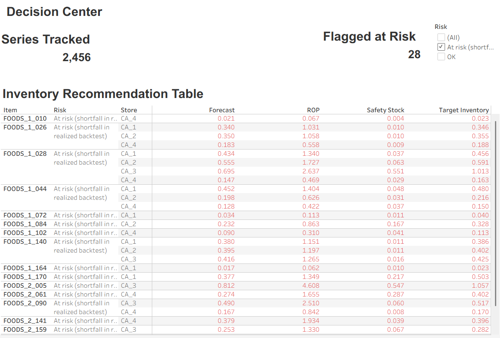

# Demand Forecasting & Inventory Optimization

An end-to-end demand forecasting and inventory optimization pipeline built on Walmart's real M5 retail sales data.

This project evaluates and compares classical time-series forecasting and machine-learning approaches using a leakage-free evaluation framework to identify the most effective forecasting model. The selected forecasts are subsequently incorporated into an inventory optimization model using Linear Programming to determine an efficient allocation of available inventory across locations.

The final allocation is evaluated against **actual realized demand**, establishing a direct connection between forecasting performance and operational inventory decisions rather than treating demand forecasting as an isolated predictive task.

---

## Business Problem

Retail organizations must address two closely connected operational questions:

What level of demand is expected in the future?
How should available inventory be allocated across locations to meet that demand efficiently?

Accurate demand forecasting is essential for effective inventory management. Overestimating demand may result in excess inventory and increased holding costs, while underestimating demand can lead to stockouts, unmet demand, and potential revenue loss.

This project integrates demand forecasting with inventory decision-making through the following workflow:

**Demand Forecast → Forecast Uncertainty → Safety Stock → Reorder Point → Inventory Allocation → Realized Cost / Stockout Evaluation**

The primary objective is to develop a robust forecasting pipeline and subsequently translate its forecasts into a constrained, data-driven inventory allocation decision.

---

## Key Results

| Metric | Result |
|---|---:|
| Best Model | **LightGBM (global)** |
| Best WMAPE | **36.17%** |
| Highest Feasible Tested Service Level | **90%** |
| Realized Cost Reduction | **82.8%** |
| Risk-Flagged Series | **28 / 2,456 (1%)** |
| Evaluation Panel | **20 series** |
| Full Sample | **2,456 series** |
| Test Horizon | **28 days** |

LightGBM achieved a **36.17% WMAPE**, compared with **48.08%** for the
Seasonal Naive baseline. This represents an approximately **24.8% relative
reduction in WMAPE** versus the baseline on the fixed 20-series evaluation
panel.

---

## Dataset

**[M5 Forecasting — Accuracy](https://www.kaggle.com/competitions/m5-forecasting-accuracy)** (Walmart), via Kaggle.

The project uses real historical Walmart retail sales data containing store-item demand together with calendar, event, promotion/SNAP, and price information.

For computational practicality, the final pipeline is restricted to:

- **State:** CA
- **Departments:** FOODS_1 and FOODS_2
- **Store-item series:** 2,456

The restriction keeps the full forecasting and optimization workflow practical on a free Google Colab runtime while retaining a substantial number of real store-item demand series.

The notebook requires the real M5 CSV files by default (`REQUIRE_REAL_DATA = True`). Synthetic data exists only as an optional pipeline sanity-check mode and is not used for the reported final results.

---

### Evaluation Scope

The project uses two evaluation scopes:

- **2,456 store-item series:** used for scalable forecasting, rolling-origin
  analysis, inventory optimization, safety stock and reorder-point analysis.
- **20-series benchmark panel:** used for the fair head-to-head comparison
  of SARIMA, LightGBM, LSTM and Seasonal Naive.

The 20-series benchmark panel was selected using **train + validation data
only**, so test-period information does not influence which series are used
for model comparison.

---

## Architecture



The workflow connects forecasting, uncertainty estimation and constrained
inventory optimization into one decision-support pipeline.

---

## Project Pipeline

```text
Real M5 Retail Data
        ↓
Data Preparation & Aggregation
        ↓
EDA + STL Decomposition
        ↓
ADF Stationarity Testing
        ↓
Chronological Train / Validation / Test Split
        ↓
┌──────────────┬──────────────┬──────────────┬──────────────┐
│ Seasonal     │ SARIMA       │ LightGBM     │ LSTM         │
│ Naive        │              │              │              │
└──────────────┴──────────────┴──────────────┴──────────────┘
        ↓
Leakage-Free Model Comparison
        ↓
Best Forecasting Model
        ↓
Forecast Uncertainty
        ↓
Safety Stock / Service-Level Scenarios
        ↓
Linear Programming Inventory Allocation
        ↓
Naive vs Optimized Allocation
        ↓
Realized-Demand Backtest
        ↓
Reorder Point & Safety Stock Recommendations
        ↓
Dashboard / Business Decisions
```

---

## Tech Stack

- **Python**
- **Pandas / NumPy** — data preparation, transformation and analysis
- **Matplotlib / Seaborn** — exploratory visualization
- **Statsmodels** — STL decomposition, ADF testing and SARIMA
- **LightGBM** — global machine-learning forecasting
- **TensorFlow / Keras** — LSTM forecasting
- **PuLP** — Linear Programming inventory optimization
- **Scikit-learn** — preprocessing and evaluation utilities
- **Tableau / HTML** — business dashboarding
- **Google Colab** — notebook development and execution

---

## Skills Demonstrated

- Time-series forecasting
- Exploratory data analysis
- Feature engineering
- Machine learning
- Deep learning
- Model evaluation
- Forecast uncertainty estimation
- Inventory optimization
- Linear Programming
- Scenario analysis
- Safety stock and reorder-point design
- Business KPI development
- Data visualization
- Dashboard development
- Translating predictive models into operational decisions

---

## Methodology

### 1. Exploratory Data Analysis & Time-Series Decomposition

Historical demand is analyzed at the daily level.

STL decomposition is used to separate:

- Trend
- Seasonal component
- Residual component

The analysis identifies strong weekly seasonality together with a changing underlying trend.

### 2. Stationarity Testing

The Augmented Dickey-Fuller (ADF) test is applied before SARIMA modeling.

Results from the final analysis:

- Raw series: non-stationary, **p = 0.539**
- After regular differencing: stationary
- After seasonal differencing: stationary, **p < 0.001**

This supports the use of:

- Regular differencing: `d = 1`
- Seasonal differencing: `D = 1`
- Weekly seasonality: `s = 7`

### 3. Chronological Train / Validation / Test Split

The data is split chronologically rather than randomly to prevent future information from leaking into model training.

```text
Train       → through 2016-02-28
Validation  → 2016-02-29 to 2016-03-27
Test        → 2016-03-28 to 2016-04-24
```

The validation period is used for tuning and uncertainty estimation.

The test period is reserved for final out-of-sample evaluation.

### 4. Fixed Evaluation Panel

A fixed **20-series evaluation panel** is used for an apples-to-apples comparison of all four forecasting approaches:

- 10 high-volume series
- 5 mid-volume series
- 5 high-intermittency series

The panel is selected using **train + validation data only**, so test-period information does not influence which series are selected.

Every model is evaluated on the same series and the same test dates.

This avoids comparing a per-series SARIMA model on one series against global machine-learning models evaluated on a different population.

---

## Forecasting Models

### Seasonal Naive Baseline

A simple weekly seasonal baseline:

```text
Forecast(t) = Demand(t - 7)
```

This provides a meaningful benchmark because retail demand contains strong weekly seasonality.

### SARIMA

A Seasonal ARIMA model is fitted per series.

The final specification is:

```text
SARIMA(1,1,2) × (0,1,1,7)
```

The specification was selected using an AIC-based grid search on a representative series.

Residual diagnostics include:

- Residual time-series inspection
- ACF
- Q-Q plot
- Ljung-Box test

The Ljung-Box diagnostics do not reject the absence of residual autocorrelation at the examined seasonal lags, although the Q-Q plot shows mild tail deviation.

### LightGBM

A global LightGBM model is trained across the store-item series.

Features include:

- Lagged demand
- Rolling averages
- Rolling standard deviation
- Calendar features
- Day-of-week
- Month
- Year
- Promotion/SNAP/event information
- Price-related information where available

The global approach allows a single model to learn common demand patterns across many store-item combinations.

### LSTM

A compact global LSTM is used as a non-linear sequence-based extension.

The purpose is not to assume that deep learning must outperform classical or tree-based approaches, but to provide a meaningful benchmark against a sequence model.

If LightGBM outperforms LSTM, this is treated as a legitimate empirical finding rather than a failure of the LSTM approach.

---

## Evaluation Metrics

The following metrics are calculated:

- **MAE** — Mean Absolute Error
- **RMSE** — Root Mean Squared Error
- **MAPE** — Mean Absolute Percentage Error
- **WMAPE** — Weighted Mean Absolute Percentage Error

### Primary Metric: WMAPE

WMAPE is treated as the primary forecasting metric because the dataset contains many zero-demand observations and ordinary MAPE can become unstable or misleading.

Lower WMAPE indicates better forecasting performance.

---

## Model Comparison

The final apples-to-apples comparison is performed on the fixed 20-series panel.

### Final Result

**Best forecasting model: LightGBM (global)**

**WMAPE: 36.17%**

This means LightGBM achieved the lowest WMAPE among the models evaluated on the selected 20-series test panel.

LightGBM reduced WMAPE by approximately **24.8% relative to the Seasonal Naive baseline** on the fixed evaluation panel.

This result should not be interpreted as a claim that LightGBM is universally the best model for the entire M5 dataset.

### Model Comparison Table

| Rank | Model | WMAPE | MAE | RMSE |
|---:|---|---:|---:|---:|
| 1 | LightGBM (global) | **36.17%** | **2.4342** | **4.1103** |
| 2 | LSTM (global) | **37.82%** | **2.5453** | **4.1998** |
| 3 | SARIMA | **39.95%** | **2.6885** | **4.8386** |
| 4 | Seasonal Naive | **48.08%** | **3.2357** | **5.5016** |

> **Important:** SARIMA is evaluated on the same 20-series panel for the apples-to-apples comparison. Separate full-sample results are retained for scalable models as additional context.

---

## Rolling-Origin Robustness Check

A single test window can be unusually easy or difficult.

Therefore, an additional rolling-origin evaluation is performed for:

- LightGBM
- Seasonal Naive

across three shifted 28-day windows.

The standard deviation of WMAPE across windows was:

| Model | WMAPE Stability |
|---|---:|
| LightGBM | **0.191** |
| Seasonal Naive | **0.394** |

Lower variation indicates more stable performance across evaluation windows.

The rolling-origin evaluation is intentionally limited to LightGBM and Seasonal Naive because repeatedly fitting SARIMA and LSTM would substantially increase runtime.

---

## Inventory Optimization

Forecasting is followed by a constrained Linear Programming inventory allocation model.

The objective is:

```text
Minimize:
Holding Cost × Inventory
+
Stockout Cost × Shortage
```

Subject to:

- Inventory capacity
- Budget constraint
- Service-level constraint
- Non-negative inventory/shortage variables

The optimization is solved using **PuLP**.

---

### Service-Level Constraint

The inventory requirement is based on forecast uncertainty:

```text
Required Inventory
=
Mean Demand
+
z × Forecast Error Standard Deviation
```

The same validation-period uncertainty estimate is used for the safety-stock calculation and service-level constraint.

The project evaluates three service-level scenarios:

```text
90%
95%
99%
```

The scenarios are explicitly checked for feasibility rather than assuming that higher service levels are always achievable.

---

### Service-Level Recommendation

The final analysis identifies:

> **90% as the highest feasible tested service level**

under the assumed budget and capacity constraints.

This is **not** presented as a universally optimal retail service level.

It means that 90% was the highest feasible target among the tested 90%/95%/99% scenarios under the project's assumed constraints.

---

## Inventory Cost Evaluation

Two inventory policies are compared:

### Naive Allocation

Inventory is allocated based directly on the forecast without the optimized cost-aware allocation framework.

### LP-Optimized Allocation

Inventory is allocated using the Linear Programming model while considering:

- Forecast demand
- Forecast uncertainty
- Holding cost
- Stockout cost
- Budget
- Capacity
- Service-level target

---

### Realized-Demand Backtest

A critical part of the project is that the allocation decision is made using the forecast, but the resulting cost is evaluated against **actual demand**.

This prevents the evaluation from simply measuring how well one forecast-based plan matches another forecast.

The final evaluation uses a:

**28-day out-of-sample test period**

---

### Final Business Result

Under the project's assumed holding and stockout cost parameters:

> **82.8% realized cost reduction**

was achieved by the LP-optimized allocation compared with the naive allocation over the 28-day out-of-sample test period.

This result is conditional on the assumed cost and operational parameters and should not be interpreted as a guaranteed real-world cost saving.

---

### Risk Flags

The realized-demand backtest identified:

> **28 of 2,456 store-item series (1%)**

with a shortfall against actual demand under the LP-optimized allocation.

These series should receive additional monitoring or potentially a higher individual service-level target.

---

## Safety Stock & Reorder Point

Safety stock is calculated from forecast uncertainty.

The project also compares:

- Normal-approximation safety stock
- Empirical forecast-error quantile safety stock

This is particularly important for intermittent-demand series where the normal-distribution assumption can be weak.

---

### Reorder Point

The reorder point follows the standard structure:

```text
ROP
=
Forecast Demand During Lead Time
+
Safety Stock
```

Illustrative department-level lead times are used:

- FOODS_1 → 3 days
- FOODS_2 → 5 days

These lead times are assumptions because the public M5 dataset does not provide supplier-specific logistics lead-time information.

---

## Business Impact

### False Positive — Over-Forecasting

If demand is overestimated:

- Excess inventory is purchased
- Holding costs increase
- Storage capacity is consumed
- Perishable goods may face wastage
- Capital is tied up unnecessarily

### False Negative — Under-Forecasting

If demand is underestimated:

- Stockouts increase
- Lost sales occur
- Customer satisfaction may decline
- Emergency replenishment may be required

The optimization framework attempts to balance these competing costs rather than simply maximizing forecast accuracy.

---

## Key Findings

1. **LightGBM was the best-performing model** among the evaluated models on the fixed 20-series panel, achieving **36.17% WMAPE**.
2. The dataset exhibits strong weekly seasonality and a changing trend, supporting explicit time-series and calendar modeling.
3. The **90% service level** was the highest feasible tested target under the assumed budget and capacity constraints.
4. The LP-optimized allocation produced an **82.8% realized cost reduction** versus the naive allocation over the 28-day test window under assumed cost parameters.
5. Only **28 of 2,456 series (1%)** were flagged for a shortfall against actual demand in the realized backtest.
6. The rolling-origin check showed that LightGBM was more stable across multiple windows than the seasonal-naive baseline.

---

## Business Recommendations

### 1. Use LightGBM as the primary forecasting candidate

LightGBM achieved the strongest WMAPE among the models evaluated on the 20-series panel while providing a scalable global forecasting framework.

### 2. Use forecast uncertainty when setting inventory

Inventory decisions should account for both expected demand and forecast uncertainty rather than using the point forecast alone.

### 3. Use 90% as a starting service-level policy

The 90% target is the highest feasible tested level under the assumed constraints. Actual service levels should be recalibrated when real business budget, capacity and cost data become available.

### 4. Prioritize the 28 flagged series

These series should be monitored more closely and may require:

- Higher individual service-level targets
- Additional safety stock
- Manual review
- Better demand features
- More frequent replenishment

### 5. Replace assumed business parameters with real operational data

A production implementation should use:

- Actual holding costs
- Actual stockout/lost-margin costs
- Supplier lead times
- Store-level capacity
- Procurement budgets
- Existing inventory
- Replenishment schedules

---

## Dashboard

The project includes three business-focused dashboard pages that translate
the forecasting and inventory-optimization results into actionable decisions.

### Dashboard Pages

#### 1. Forecast Performance

Compares the forecasting models using WMAPE, MAE, RMSE, and model ranking.

**Primary question:**  
> Which forecasting model should the business use?

LightGBM (global) provides the strongest forecasting performance based on the lowest WMAPE.

View the [live interactive dashboard on Tableau Public](https://public.tableau.com/app/profile/maanya.saxena/viz/ForecastPerformance_17882715469100/Dashboard1?publish=yes).

#### 2. Inventory Optimization

Shows service-level feasibility, inventory cost, holding vs. stockout cost,
and the realized cost impact of the optimized allocation.

**Primary question:**  
> How does the optimized allocation change inventory cost and stockout risk?

The optimized allocation reduces inventory-related cost while maintaining the highest feasible service level of 90%; higher service-level targets are infeasible under the current constraints.

View the [live interactive dashboard on Tableau Public](https://public.tableau.com/app/profile/maanya.saxena/viz/INVENTORYOPTIMIZATION/INVENTORYOPTIMIZATION).

#### 3. Inventory Decision Center

Provides store- and item-level inventory recommendations, including forecast
demand, safety stock, reorder point, target inventory, and risk status.

**Primary question:**  
> What should each store-item combination hold or replenish?

The dashboard provides item-level forecast demand, safety stock, reorder point, target inventory, and risk status to support replenishment decisions.

View the [live interactive dashboard on Tableau Public](https://public.tableau.com/app/profile/maanya.saxena/viz/DecisionCenter_17882911980250/DecisionCenter).


## Limitations

### Assumed Costs

Holding cost, stockout cost, budget and capacity are illustrative because the public M5 dataset does not provide the company's actual operational cost structure.

### Assumed Lead Times

The reorder-point calculations use illustrative department-level lead times rather than real supplier logistics data.

### Single 28-Day Test Window

The realized cost comparison is based on one 28-day out-of-sample period.

The additional rolling-origin robustness check covers three windows for LightGBM and Seasonal Naive.

### 20-Series Benchmark Panel

The head-to-head SARIMA, LightGBM, LSTM and Seasonal Naive comparison uses a fixed 20-series panel.

The broader 2,456-series sample is used for scalable forecasting and inventory analysis.

### Approximate Uncertainty Distribution

Safety stock uses a normal approximation for forecast errors.

An empirical quantile comparison is also performed because this assumption can be weaker for intermittent-demand series.

### Constructed Budget and Capacity

Budget and capacity constraints are derived assumptions designed to make the service-level feasibility analysis meaningful.

They are not real Walmart operating constraints.

### Single-Period Allocation

The LP is a single-period allocation framework.

It does not model a complete multi-period replenishment system with:

- Opening inventory
- Purchase orders
- Pipeline inventory
- Supplier lead-time dynamics
- Inventory carry-over


## Repository Structure

```text
demand-forecasting-inventory-optimization/
│
├── demand_forecasting_inventory_optimization.ipynb
│
├── diagrams/
│   ├── pipeline_architecture.svg
│   ├── forecast_to_inventory_flow.svg
│   ├── screenshot_forecast_performance.png
│   ├── screenshot_inventory_optimization.png
│   └── screenshot_decision_center.png
│
├── outputs/
│   ├── model_comparison_panel_apples_to_apples.csv
│   ├── model_comparison_full_sample_context.csv
│   ├── model_comparison_ranked.csv
│   ├── service_level_scenario_scan.csv
│   ├── naive_vs_optimized_cost_summary_projected_and_realized.csv
│   ├── lp_allocation_plan.csv
│   ├── inventory_decision_table.csv
│   ├── reorder_points_safety_stock.csv
│   └── safety_stock_normal_vs_empirical.csv
│
├── requirements.txt
│
└── README.md

```

## Outputs

The notebook exports presentation-ready CSV files for forecasting comparison,
inventory optimization, and downstream dashboarding.

### Forecasting

```text
model_comparison_panel_apples_to_apples.csv
model_comparison_full_sample_context.csv
model_comparison_ranked.csv
```

### Inventory Optimization

```text
service_level_scenario_scan.csv
naive_vs_optimized_cost_summary_projected_and_realized.csv
lp_allocation_plan.csv
```

### Inventory Decisions

```text
inventory_decision_table.csv
reorder_points_safety_stock.csv
safety_stock_normal_vs_empirical.csv
```

## Disclaimer

This is a portfolio/research project using publicly available Walmart M5 data.

The inventory costs, budget, capacity and lead-time assumptions are illustrative and should be replaced with real operational parameters before use in production.
